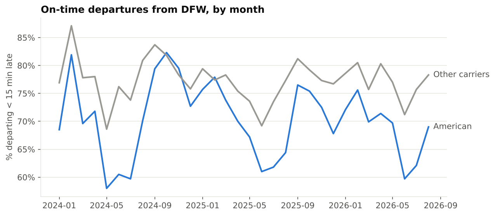
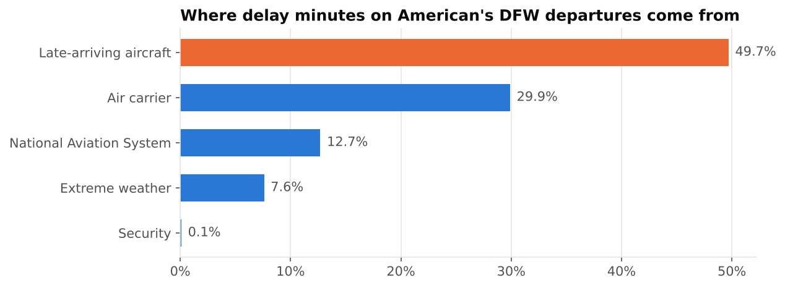
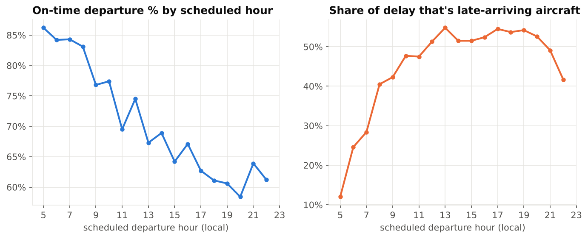
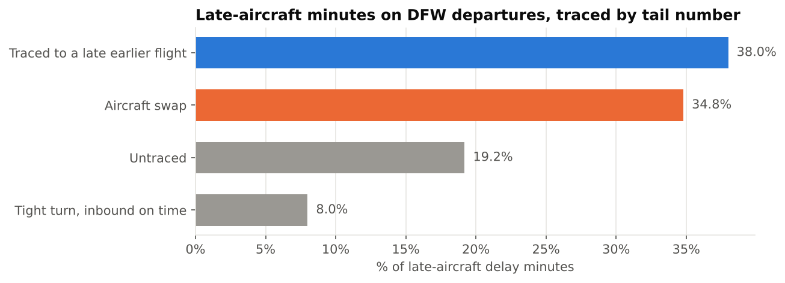
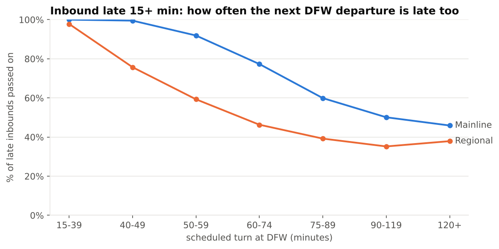
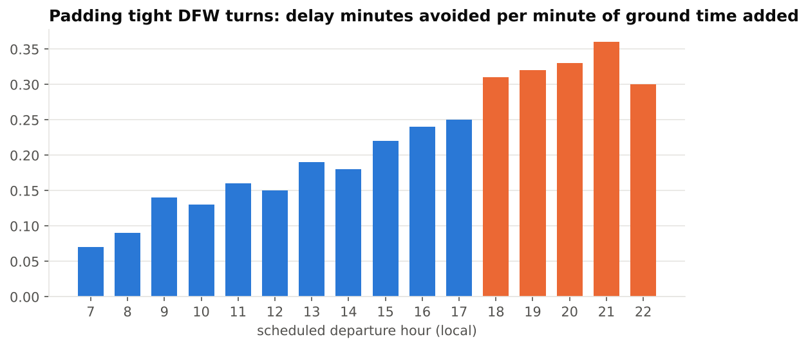

# DFW flight delays: where American's hub loses time

SQL project on U.S. DOT on-time data, Jan 2024 to Aug 2026. Everything is done in PostgreSQL;
Python only downloads the files, loads them and draws the charts at the end.

I live near DFW and fly out of it a lot, and in my transportation operations job at UNT I
spend a lot of time on "why is this late" questions, so I wanted to see whether the data
backs up the feeling that DFW is always running behind. It does. American is the biggest
carrier at DFW by a lot (it's their largest hub), so that's the focus.

**Questions**

1. How does DFW compare with American's other hubs, and with the other airlines at DFW?
2. Where do the delay minutes come from: which causes, which hours, which routes?
3. Half the delay is "late-arriving aircraft". BTS doesn't say what made the plane late
   in the first place. Can that be traced?
4. Where in the schedule could a small change actually help?
5. Which flights would DOT call "chronically delayed", and roughly what is all this costing?

## Data

Bureau of Transportation Statistics, [Reporting Carrier On-Time Performance](https://www.transtats.bts.gov/DL_SelectFields.aspx?gnoyr_VQ=FGJ).
Airlines over a revenue threshold are required to report every domestic flight: schedule,
actual times, tail number, and delay minutes split into five causes (carrier, weather,
National Aviation System, security, late aircraft).

- 32 monthly files, 18.8M flights nationally
- `python/download_bts.py` keeps everything flown by American and its two wholly owned
  regionals (Envoy `MQ`, PSA `OH`) anywhere in the country, plus every flight in or out of
  DFW by any airline. That's **4,414,013 flights**. The whole American network is kept,
  not just DFW, because the delay tracing follows planes after they leave DFW.
- It also writes national totals by carrier and month so there's an industry benchmark
  without keeping all 18.8M rows.

The raw files are not in the repo (about 120 MB). Run the download script to get them.

## How it's built

```
raw   ->  stg   ->  core                ->  mart
text      typed     fact_flight             analysis tables
as-is     dedupe    dim_carrier             (one per question)
          times     dim_airport
                    dim_date
```

| file | what it does |
|---|---|
| `sql/01_schema.sql` | schemas, tables, keys, carrier lookup |
| `sql/02_staging.sql` | casts types, builds timestamps (handles `2400` and overnight arrivals), removes duplicates |
| `sql/03_core.sql` | builds the dims and the fact table, adds on-time flags using the DOT definitions |
| `tests/data_quality.sql` | 11 checks, e.g. row counts vs the download log, causes add up to the arrival delay, no causes on flights under 15 min late |
| `sql/04_indexes.sql` | indexes |
| `sql/05_kpis.sql` | DFW monthly, hub ranking, national benchmark |
| `sql/06_delay_causes.sql` | cause mix, hour of day, day of week |
| `sql/07_routes.sql` | route scorecard, month over month and year over year, rolling 30-day on-time |
| `sql/08_knock_on.sql` | tail-number delay chains (the main one, see below) |
| `sql/09_turns.sql` | scheduled turn time vs how much delay gets passed on, plus a padding what-if |
| `sql/10_performance.sql` | EXPLAIN ANALYZE with and without the indexes |
| `sql/11_chronic_delays.sql` | DOT chronically delayed flight test by flight and month, plus streaks |
| `sql/12_cost_of_delay.sql` | puts a dollar figure on the findings, with the assumptions kept in a table |

The data model is in [docs/data_model.md](docs/data_model.md), and how each metric is defined
is in [docs/metric_definitions.md](docs/metric_definitions.md).

Run it:

```
createdb flights
pip install -r requirements.txt
python3 python/download_bts.py          # ~20 min, writes to ~/Downloads/bts_dfw
./run_all.sh ~/Downloads/bts_dfw
```

All 11 data quality checks pass. Nothing was lost between raw and core, and there were 0
duplicate flights.

## What I found

"American" below means AA mainline + Envoy + PSA flying out of DFW, 662,662 departures.
On-time means it left the gate less than 15 minutes late.

### 1. DFW is American's worst hub, every year

| | 2024 | 2025 | 2026 (Jan-Aug) |
|---|---|---|---|
| DFW on-time departures | 70.9% | 70.0% | 68.4% |
| DFW rank among the 10 AA hubs | 10th | 10th | 10th |
| best hub | JFK 85.0% | JFK 84.0% | JFK 79.9% |

DFW also runs behind the other airlines at the same airport: 69.9% on-time for American vs
77.3% for everyone else, with the same weather and the same air traffic control. Inside
American, mainline is the problem: **AA mainline 64.6%**, PSA 74.1%, Envoy 81.9%.



Summer is the worst every year (May to Aug), which fits Texas thunderstorm season.

### 2. Half the delay is planes showing up late, and it builds through the day



Late-arriving aircraft is 49.7% of delay minutes on American's DFW departures. Weather
(the "extreme weather" category) is only 7.6%, though BTS counts normal weather under NAS.



Departures before 8am leave on time about 84% of the time. By 6 to 8pm it's around 60%,
and over half the delay at that point is inherited from earlier flights. That's the
classic hub snowball pattern.

### 3. It isn't a route problem

149 routes out of DFW have 1,000+ American departures. The worst route (SAT) is only 2.3%
of total delay minutes, and the top 15 together are 27%. No single route explains much, so
route-by-route fixes won't move the hub number. Late aircraft is the top cause on every one
of the top 15 routes. (Full table: `mart.route_scorecard`.)

### 4. Tracing late-aircraft delay back to where it started

This is the main part of the project. Every flight has a tail number, so in
`08_knock_on.sql` I rebuilt the sequence of flights for each of 1,403 American aircraft
(`LAG()` over tail number ordered by actual departure), checked that each flight really
connects to the one before it (same airport, under 6 hours on the ground), and then used
a gaps-and-islands running sum to group consecutive late-aircraft flights into **chains**.
The first flight in a chain is the root.

To make sure the chain logic was right, I also walked the chains forward with a recursive
CTE. Both methods give the same count (20,177 legs for the last month checked).

Here's one chain the recursive query pulls out, Envoy N786SM on June 5, 2024. One late
morning arrival and the plane never caught up:

| step | flight | route | dep delay | late aircraft min |
|---|---|---|---|---|
| 0 | MQ3314 | HOU-DFW | 34 | 0 (root, arrived 103 late) |
| 1 | MQ3909 | DFW-FWA | 95 | 75 |
| 2 | MQ3909 | FWA-DFW | 77 | 76 |
| 3 | MQ3455 | DFW-GRK | 64 | 55 |
| 4 | MQ3455 | GRK-DFW | 100 | 79 |
| 5 | MQ3453 | DFW-FSM | 87 | 87 |
| 6 | MQ3453 | FSM-DFW | 107 | 95 |
| 7 | MQ3510 | DFW-GCK | 122 | 116 |

Across all late-aircraft minutes on American's DFW departures:



- **38%** trace back to an earlier flight on the same plane that really was late. For those,
  60% of the time the root was the flight into DFW, 34% it was the plane's previous trip out
  of DFW coming back late, and 6% it started 2+ flights back.
- **35% are aircraft swaps.** The plane that flew the departure landed on time, but it was
  scheduled to arrive after (or just minutes before) the departure, so it was never planned
  for that flight. Usually the scheduled "turn" is negative. The airline still codes the
  delay as late aircraft, because the plane that was supposed to fly it was late, but that
  plane is a different tail, so it can't be traced. I didn't expect this group to be so big.
- 8%: the plane landed on time and the turn itself ran long.
- 19% couldn't be linked (overnight sits, diversions).

Looking at every chain that reached a DFW departure, by what the root flight's own delay was
coded as: swaps 43%, carrier 19%, NAS 17%, tight turn 10%, weather 7%, and 4% where the
root was itself late from a flight I couldn't link.

### 5. Short turns pass the delay straight through

For every late inbound at DFW (15+ min), how often the next departure on that plane also
left 15+ late:

| scheduled turn (min) | 15-39 | 40-49 | 50-59 | 60-74 | 75-89 | 90-119 | 120+ |
|---|---|---|---|---|---|---|---|
| mainline | 100% | 99.5% | 91.9% | 77.3% | 59.9% | 50.1% | 45.9% |
| regional | 97.8% | 75.7% | 59.3% | 46.3% | 39.2% | 35.2% | 37.9% |



For mainline, turns under 60 minutes pass on more than 90% of inbound delay, and the
outbound usually ends up *later* than the inbound was. It takes 90+ minutes before it's a
coin flip. Regional jets turn faster: the practical minimum (10th percentile of actual
turns when the inbound was 30+ late) is 34 min regional vs 50 min mainline.

**What-if:** pad every turn with less than 15 minutes of buffer up to 15 minutes. That touches
41% of mainline turns, adds 1.5M minutes of ground time over the period, and saves about
350k minutes of late-aircraft delay. That's roughly 18% of the mainline late-aircraft minutes
in that turn set, but only 0.23 delay minutes saved per minute added. Padding everything
is expensive.

Where it's worth it depends on the hour:



Padding the 6pm to 10pm departures returns about 0.3 delay minutes per ground minute,
4x what it does in the morning. That window is 27% of the added ground time and 41% of the
delay saved.

### 6. Chronically delayed flights

DOT has a rule for this ([14 CFR 399.81](https://www.ecfr.gov/current/title-14/section-399.81)).
A flight that runs at least 10 times in a month and arrives more than 30 minutes late (or is
cancelled) more than half the time is "chronically delayed". Keeping one on the schedule for
more than four months in a row counts as an unfair and deceptive practice. In 2024 and 2025
DOT fined or sued airlines over this.

Running that test on every American flight number in or out of DFW, month by month
(`11_chronic_delays.sql`):

- 1,549 flight-months met the definition, covering 992 different flights.
- The worst month was **May 2024: 288 chronically delayed flights**, 20% of everything eligible.
  Summer is the problem every year (Jun-Jul 2025 and Jun-Jul 2026 are next).
- Nobody crossed the legal line. The longest streak is exactly 4 months. That happened 6
  times (5 different flights), all May through August, and 4 of the 6 were DFW-DEN
  (AA662 did it in both 2024 and 2025).
  So American seems to fix or re-time these just in time, or the season ends first. Either
  way, DFW-DEN in summer is the route to watch.
- Chronic flights out of DFW are almost all afternoon and evening departures. 19:00 alone
  has 209 flight-months, versus 1 at 9am. That's the same evening bank as finding 5.

### 7. Rough cost

Using Airlines for America's 2025 figure of **$98.41 per block minute** (direct airline cost:
crew, fuel, maintenance, ownership; [A4A](https://www.airlines.org/dataset/u-s-passenger-carrier-delay-costs/)),
kept in a `mart.assumptions` table so it's easy to change:

| | per year |
|---|---|
| all delay on American's DFW departures (2025) | 5.1M min, about **$506M** |
| late-arriving aircraft part of that | about $245M |
| aircraft swaps (from finding 4) | about $87M |
| padding only the evening bank's tight turns | saves about **$6.1M** for ~9 aircraft-hours a day of extra ground time |

These are order-of-magnitude numbers. They leave out passengers' time, missed connections
and rebooking, so the real cost of delay is higher. On the other side, not every delay minute
burns a full block minute of cost.

### Dashboard

The main charts are also in a Tableau dashboard built from `tableau/dashboard_data.csv`
(one long file, each sheet filters on the `chart` column). Link: to be added once it's
published on Tableau Public.

## What I'd recommend

1. **Fix the evening bank first.** Add buffer to tight mainline turns on 6pm to 10pm departures.
   That's where the delay has piled up, where the chronically delayed flights are, and where
   each padded minute saves the most (about $6M a year for less than one plane's worth of
   daily flying). Don't pad mornings: flights are mostly on time then and padding barely helps.
2. **Treat 60 minutes as the floor for mainline turns at DFW.** Below that, almost all inbound
   delay goes straight through.
3. **Look at swap decisions.** About a third of inherited delay at DFW comes from planes
   that were swapped in and were already scheduled to arrive late. The data can't show why
   each swap happened, but at roughly $87M a year it's big enough for someone in ops
   control to dig into (spare aircraft at DFW, swap rules).
4. **Watch summer DFW-DEN.** Several flights there are chronically delayed for 4 straight
   months, one short of the DOT line. Re-time them before May, not after.
5. **Otherwise, don't go route by route.** The delay is spread across the whole hub, so the fix has to be
   in the schedule structure (banks and turns), not in individual routes.

## Limitations

- Delay causes are reported by the airlines and only for flights 15+ minutes late. How a
  minute gets coded as "carrier" vs "NAS" is partly a judgment call by each airline.
- All times are local. Linking flights only compares times at the same airport so that's fine,
  but ordering a plane's day across time zones relies on actual departure times plus the
  airport check.
- SkyWest and Republic also fly some American Eagle routes, but BTS lists flights under the
  operating airline, so those are counted under "other carriers" at DFW and not followed
  in the chains.
- The padding what-if is rough: one buffer minute absorbs one minute of delay, and there's
  no cost for gates, crews or fewer flights per plane per day.
- Not every turn can be padded. Connections and crew rules aren't in this data.
- The dollar figures use one industry-average cost per minute for all aircraft types. A
  regional jet minute costs less than a widebody minute.
- The chronic delay test uses the operating carrier's flight number. DOT applies the rule
  to whoever markets the flight, which for Envoy and PSA is American anyway.

## Performance note

The knock-on analysis leans on looking up a plane's flights in order. On 4.4M rows
(`10_performance.sql`, local Postgres 16):

| query | no index | with index |
|---|---|---|
| one route, one quarter (DFW-ORD, summer 2025) | ~60 ms | ~17 ms |
| one aircraft's full history in order | ~245 ms | ~9 ms |

(numbers move around a bit between runs, these are typical)

The full pipeline (`run_all.sh`, load to final tables) runs in about 5 minutes.

## Repo layout

```
python/    download_bts.py, load_postgres.py, make_charts.py, export_tableau.py
sql/       01-12, run in order (run_all.sh does it)
tests/     data_quality.sql
charts/    README charts
docs/      data model, metric definitions
output/    text output from each analysis file
tableau/   CSVs the Tableau dashboard is built from (python/export_tableau.py)
```
