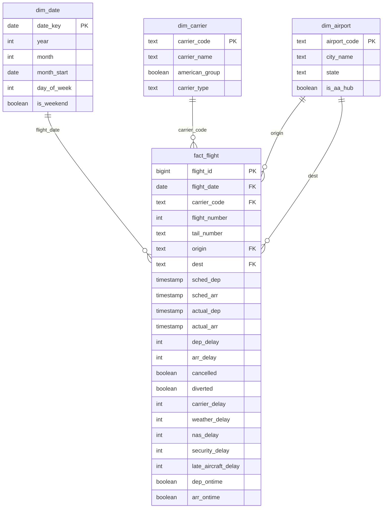

# Data model

One row in `fact_flight` = one scheduled flight. Natural key is
`(flight_date, carrier_code, flight_number, origin, sched_dep)` with a unique constraint on it.

## Schemas

| schema | purpose |
|---|---|
| `raw` | the CSV columns exactly as downloaded, all text, plus the file name each row came from |
| `stg` | typed and cleaned, timestamps built, duplicates removed (and kept in `stg.duplicates_removed`) |
| `core` | the star schema above |
| `mart` | one table per analysis question, rebuilt by files 05-09 |

## Notes on the tricky columns

- **Times.** BTS gives `CRSDepTime` / `CRSArrTime` as `hhmm` local time and no arrival date.
  Arrival is pushed to the next day when local arrival minus local departure is more than 7
  hours less than the scheduled block time. More than 7 hours can't be explained by time zones.
  Checked: 0 flights where the scheduled duration and the block time disagree by more than
  400 minutes after this.
- **Actual times** = scheduled + delay minutes, instead of parsing `DepTime` / `ArrTime`,
  which wrap around midnight.
- **Delay causes** are only filled when `arr_delay >= 15`, and they add up to `arr_delay`
  (tested).
